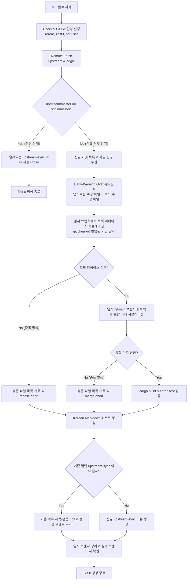

# 업스트림 변경 감지 및 패치 스택 검증 가이드 (hj-upstream-watch)

본 문서는 `5solas/gitui` 포크 저장소에서 업스트림(`gitui-org/gitui`)의 변경 사항을 자동으로 감지하고, 포크의 패치 스택(토픽 브랜치들 및 `hj/main`)에 대한 리베이스 및 통합 머지 가능 여부를 지속적으로 검증하는 GitHub Actions 워크플로 및 보조 스크립트(`eng/hj/Watch-Upstream.ps1`)의 구조와 운영 방식을 설명합니다.

---

## 1. 개요 및 목적 (Overview & Goals)

포크 저장소는 업스트림 최신 변경 사항과의 호환성을 유지하기 위해 패치 스택 모델(`master` -> 개별 토픽 브랜치 리베이스 -> `hj/main` 통합 머지)을 따릅니다.
`hj-upstream-watch` 시스템은 원격 브랜치를 변경하지 않고(Read-Only), 백그라운드에서 주기적으로 다음을 수행합니다:

1. **업스트림 추적**: `upstream/master`에 새로운 커밋이 발생했는지 확인합니다.
2. **사전 파일 중복 감지 (Early-Warning Overlaps)**: 업스트림에서 변경된 파일과 포크의 토픽 브랜치들이 수정한 파일 간의 교집합을 찾아 잠재적 충돌 위험을 조기에 경고합니다.
3. **가상 리베이스 및 통합 검증 (Dry-Run)**: 실제 브랜치를 변경하지 않고 임시 테스트 브랜치(`tmp/watch-*`)를 생성하여 각 토픽 브랜치의 리베이스 및 `hj/main` 통합 머지를 시뮬레이션합니다.
4. **빌드 및 테스트 검증**: 충돌 없이 머지 가능한 경우 `cargo build --locked` 및 `cargo test --workspace --locked`를 수행하여 컴파일/테스트 호환성을 확인합니다.
5. **단일 이슈 리포팅**: `upstream-sync` 라벨이 지정된 단일 GitHub Issue를 생성하거나 갱신하여 관리자에게 한국어 요약 리포트와 로컬 조치 명령을 제공합니다.

---

## 2. GitHub Actions 워크플로 (`.github/workflows/hj-upstream-watch.yml`)

### 트리거 (Triggers)
- **정기 스케줄 (`schedule`)**: 매일 UTC 02:23(KST 11:23)에 1회 자동 실행됩니다. (:00 정각을 피해 GitHub Actions 부하 스파이크 방지)
- **수동 실행 (`workflow_dispatch`)**:
  - `base_ref`: 과거 커밋 SHA나 브랜치를 지정하여 신규 커밋 감지 시나리오를 수동 시뮬레이션 테스트할 수 있습니다.
  - `skip_build`: 빠른 검증을 위해 `cargo build` 및 `test` 단계를 건너뛸 수 있습니다.
  - `no_issue`: 이슈 생성/수정을 건너뛰고 워크플로 로그로만 결과를 확인합니다.

### 권한 및 동시성 제어 (Permissions & Concurrency)
```yaml
permissions:
  contents: read
  issues: write

concurrency:
  group: hj-upstream-watch
  cancel-in-progress: false
```
- 리모트 브랜치나 태그를 절대 변경하지 않으므로 `contents: read` 권한만 사용합니다.
- 이슈 생성 및 갱신을 위해 `issues: write` 권한이 부여됩니다.
- 중복 실행으로 인한 이슈 상태 꼬임을 방지하기 위해 단일 동시성 그룹(`hj-upstream-watch`)으로 순차 실행됩니다.

---

## 3. 핵심 동작 절차 (Workflow Architecture)



### 주요 검증 원칙
1. **무변경 원칙 (No-Push Safety)**:
   - 본 워크플로는 어떠한 경우에도 원격 저장소(`origin`)에 `push`, `force-push`, 태그 생성, 또는 릴리스 생성을 수행하지 않습니다.
   - 모든 검증은 임시 브랜치(`tmp/watch-*`)에서 진행되며 `finally` 블록에서 안전하게 삭제됩니다.
2. **이슈 기반 신호 체계 (Issue-as-Signal)**:
   - 패치 스택 리베이스나 머지 중 충돌(Conflict)이 발생하더라도 워크플로 자체는 Exit 0으로 정상 완료(Green) 처리됩니다.
   - 워크플로가 빨간색(Red)으로 실패하는 경우는 네트워크 단절, 도구 누락 등 예상치 못한 시스템 장애 발생 시로 제한됩니다.
3. **멱등성 보장 (Idempotency)**:
   - 동일한 업스트림 커밋에 대해 워크플로가 여러 번 실행되어도 중복 이슈를 생성하지 않고 기존 이슈의 제목과 본문을 업데이트하고 코멘트를 추가합니다.
   - 이후 로컬에서 `Sync-Upstream.ps1 -Push`를 통해 `origin/master`가 최신화되면, 다음 실행 시 열려 있는 이슈를 감사 메시지와 함께 자동으로 닫습니다(Close).

---

## 4. 로컬 도구 사용법 (`eng/hj/Watch-Upstream.ps1`)

로컬 환경에서도 워크플로와 동일한 검증 로직을 직접 실행할 수 있습니다.

### 파라미터 안내
- `-NoIssue`: GitHub Issue를 건너뛰고 콘솔 출력 및 파일로만 리포트를 확인합니다 (로컬 테스트 시 필수 권장).
- `-BaseRef <SHA/Ref>`: 가상의 기준 커밋을 지정하여 업스트림 변경을 시뮬레이션합니다.
- `-SkipBuild`: `cargo build` 과정을 생략합니다.
- `-SkipTests`: `cargo test` 과정을 생략합니다.
- `-SkipFetch`: 로컬에 이미 최신 리모트 정보가 있을 때 추가 fetch를 생략합니다.
- `-ReportPath <Path>`: 생성된 마크다운 보고서를 파일로 저장합니다.
- `-SummaryJson <Path>`: 결과를 JSON 파일로 저장합니다.

### 실행 예시

```pwsh
# 1. 로컬 환경에서 현재 업스트림 변경 여부 안전 검사 (이슈 조작 안 함)
pwsh -NoProfile -File eng/hj/Watch-Upstream.ps1 -NoIssue -SkipBuild -SkipTests

# 2. 신규 커밋 감지 시나리오 시뮬레이션 (이전 커밋을 base로 지정)
pwsh -NoProfile -File eng/hj/Watch-Upstream.ps1 -BaseRef d78d2647 -NoIssue -SkipBuild -SkipTests

# 3. 전체 빌드 및 테스트를 포함한 로컬 사전 점검
pwsh -NoProfile -File eng/hj/Watch-Upstream.ps1 -NoIssue
```

---

## 5. 업스트림 알림 수신 후 동기화 조치 방법

`upstream-sync` 이슈가 생성되거나 업데이트되면 관리자는 안내된 로컬 명령에 따라 동기화를 진행합니다.

### 시나리오 A: 충돌 없이 정상 적용 가능한 경우 (Clean)
```pwsh
# 1. 드라이런으로 브랜치 적용 사전 확인
pwsh -NoProfile -File eng/hj/Sync-Upstream.ps1 -DryRun

# 2. 로컬 동기화 및 빌드/테스트 수행
pwsh -NoProfile -File eng/hj/Sync-Upstream.ps1

# 3. 원격(origin) 저장소로 푸시 (--force-with-lease)
pwsh -NoProfile -File eng/hj/Sync-Upstream.ps1 -Push
```

### 시나리오 B: 충돌이 감지된 경우 (Conflict)
이슈의 충돌 파일 목록을 확인하고 해당 토픽 브랜치에서 수동으로 리베이스를 해결합니다:
```pwsh
# 1. 최신 리모트 가져오기
git fetch upstream; git fetch origin

# 2. 충돌이 발생한 토픽 브랜치로 이동 및 리베이스
git checkout <conflicted-topic>
git rebase upstream/master

# 3. 충돌 파일 수정 후 리베이스 완료
git add <resolved-files>
git rebase --continue

# 4. 전체 동기화 스크립트 실행 및 푸시
pwsh -NoProfile -File eng/hj/Sync-Upstream.ps1 -Push
```
푸시가 완료되면 다음 날 또는 수동 워크플로 실행 시 `upstream/master == origin/master`가 성립하여 이슈가 자동으로 닫힙니다.
